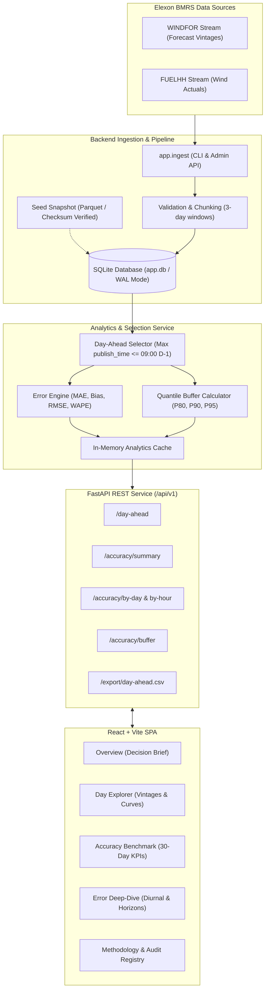

# Wind Generation Forecast Monitor · Day-Ahead Decision Desk

[](https://github.com/anonymous/wind-generation-forecast-monitor/actions/workflows/ci.yml)
[](https://opensource.org/licenses/MIT)
[](https://python.org)
[](https://react.dev)
[](https://fastapi.tiangolo.com)
[](https://tailwindcss.com)

A specialized operational decision-support desk designed for UK wholesale power purchasing teams. The system answers the two most critical questions facing trading desks ahead of day-ahead auction gates:

1. **What is the latest National Grid ESO / Elexon wind generation forecast available when the purchase decision must be locked?**
2. **How accurate have these forecasts historically proven, and what empirical safety buffer (in MW) guarantees a 90% shortfall protection against imbalance penalty prices?**

---

## AI Tooling & Pairing Disclosure

In accordance with transparent engineering practices and assignment guidelines, the following AI tools and platforms were utilized in the creation of this project:

- **Google Antigravity**: Primary agentic coding assistant used for end-to-end full-stack implementation, interactive debugging, test authoring, and real-time browser visual verification across desktop and tablet breakpoints.
- **Anthropic Claude**: System architecture design, mathematical domain modeling, and technical software specification documentation (`SOFTWARE_SPEC.md` and `ARCHITECTURE.md`).
- **Google Stitch**: UI design system exploration, responsive component styling, tabular figure typography, and visual tokens (`docs/design.md` and `docs/animation.md`).

---

## Key Features

- **Strict Day-Ahead Cut-off Enforcement**: Freezes forecast publication vintages at a configurable gate (default **09:00 London time on D-1**) to mirror physical trading desks and prevent look-ahead bias.
- **Audited January 2026 Baseline**: 1,488 verified settlement periods from Elexon BMRS (`FUELHH` actuals vs `WINDFOR` forecasts) with 100% data coverage.
- **Quantile Procurement Safety Margin**: Calculates empirical, non-parametric buffers (P80, P90, P95) per diurnal operating block (Morning Ramp, Afternoon Trough, Evening Peak, Night Baseline).
- **Comprehensive Error Breakdown**: Analyzes Mean Absolute Error (MAE), Signed Directional Bias (+/- MW), Root Mean Square Error (RMSE), WAPE, and empirical Shortfall Probability.
- **Universal RFC 4180 CSV Export**: One-click download across all 5 views with UTF-8 Byte Order Mark (`\uFEFF`) and CRLF formatting for direct Excel analysis.
- **Responsive Energy Trading Interface**: Built with Tailwind CSS v4, custom SVG charting, zero external charting bloat, and adaptive layouts tested on mobile, tablet (iPad Air/Pro), and desktop.

---

## System Architecture



---

## Project Structure

```text
├── .github/
│   └── workflows/
│       └── ci.yml               # GitHub Actions CI (Backend tests, Frontend build, Docker)
├── api/
│   ├── index.py                 # Vercel Serverless Function entrypoint (FastAPI)
│   └── requirements.txt         # Serverless Python dependencies
├── backend/
│   ├── app/
│   │   ├── analytics/           # Day-ahead selection, metrics, quantiles, and export
│   │   ├── elexon/              # BMRS API client, HTTP retry handler, and constants
│   │   ├── config.py            # Pydantic v2 environment configuration
│   │   ├── db.py                # SQLAlchemy 2.0 SQLite engine with WAL mode
│   │   ├── ingest.py            # Data ingestion, chunking, validation, and seed bootstrap
│   │   ├── main.py              # FastAPI app instance, routes, and static file mount
│   │   ├── middleware.py        # Request tracing, rate limiting, and RFC 7807 problem handlers
│   │   ├── models.py            # ActualWind, WindForecast, and IngestRun tables
│   │   └── schemas.py           # Pydantic serialization schemas
│   ├── data/
│   │   ├── app.db               # Audited SQLite database (1,488 verified periods)
│   │   └── seed/                # Parquet seed snapshots and SHA-256 checksums
│   ├── tests/                   # 73 unit, integration, and property test suites
│   ├── Dockerfile               # Backend standalone Docker container
│   ├── pyproject.toml           # Pytest & Ruff configurations
│   └── requirements.txt         # Production backend dependencies
├── frontend/
│   ├── src/
│   │   ├── api/                 # Strongly-typed API client and fallback data
│   │   ├── components/          # Reusable KpiTiles, charts, banners, and layout header/footer
│   │   ├── pages/               # 5 core operational views (Overview, Day, Accuracy, Deep-Dive, Method)
│   │   └── utils/               # Universal RFC 4180 CSV export engine
│   ├── index.html
│   ├── package.json
│   └── vite.config.ts           # Vite + Tailwind CSS v4 setup with local API proxy
├── Dockerfile                   # Multi-stage production container (Frontend + Backend)
├── docker-compose.yml           # One-command orchestration
├── package.json                 # Monorepo root build script
├── vercel.json                  # Vercel full-stack deployment configuration
└── README.md                    # This document
```

---

## Quick Start: Running Locally

### Option 1: One-Command Docker Compose (Recommended)

The easiest way to run the entire stack. Builds the React frontend, packages it into the Python backend, boots SQLite with pre-seeded data, and serves the application:

```bash
docker compose up --build
```

- **Application URL**: [http://localhost:8000](http://localhost:8000)
- **Interactive Swagger API Docs**: [http://localhost:8000/api/docs](http://localhost:8000/api/docs)
- **Readiness Check**: [http://localhost:8000/api/v1/ready](http://localhost:8000/api/v1/ready)

---

### Option 2: Native Local Development

#### 1. Backend Setup (FastAPI)
```bash
# Navigate to backend directory
cd backend

# Create and activate Python 3.11+ virtual environment
python -m venv .venv
# Windows:
.\.venv\Scripts\activate
# macOS/Linux:
source .venv/bin/activate

# Install dependencies
pip install -r requirements.txt
pip install pytest pytest-asyncio respx httpx

# Start backend server
python -m uvicorn app.main:app --host 127.0.0.1 --port 8000 --reload
```
The backend initializes SQLite and auto-seeds the verified January 2026 dataset on startup.

#### 2. Frontend Setup (React + Vite)
In a separate terminal:
```bash
cd frontend

# Install Node dependencies
npm install

# Start Vite development server with Hot Module Replacement
npm run dev
```
Open **[http://localhost:5173](http://localhost:5173)** in your browser. All API requests to `/api/v1` are automatically proxied to `http://127.0.0.1:8000`.

---

## Data Ingestion & Timeline Reference

### The GB Day-Ahead Trading Timeline
To prevent look-ahead bias, this monitor models the physical operational constraints of the GB power market:

```text
  D-2 18:00       D-1 05:00       D-1 08:00      D-1 09:00       D-1 09:30 - 11:00     Day D 00:00 - 24:00
┌───────────┐   ┌───────────┐   ┌───────────┐   ┌───────────┐   ┌─────────────────┐   ┌───────────────────┐
│   ECMWF   │───▶   Early   │───▶  Locked   │───▶ Decision  │───▶ Day-Ahead Power │───▶ Physical Delivery │
│ Baseline  │   │  Update   │   │ Vintage   │   │  Cut-off  │   │ Auction Window  │   │ (48 SP Intervals) │
└───────────┘   └───────────┘   └───────────┘   └───────────┘   └─────────────────┘   └───────────────────┘
                                      ▲               │
                                      └───────────────┘
                                   Selected Run (Latest <= 09:00)
```

1. **Forecast Ingestion (`WINDFOR`)**: Published every 30 to 60 minutes by National Grid ESO. Each vintage predicts power output for the next 48 to 168 settlement periods.
2. **Decision Cut-off (09:00 London)**: Power traders submit bids to EPEX SPOT and Nord Pool power auctions between 09:30 and 11:00 London time. The monitor selects the latest forecast vintage published **on or before 09:00 London on D-1**. Any run published after 09:00 is strictly excluded.
3. **Outturn Reconciliation (`FUELHH`)**: Physical metered wind generation published within 15 minutes of half-hour settlement period completion.

---

### Ingesting New Data for New Date Ranges

The pipeline supports on-demand ingestion directly from the live Elexon BMRS Insights API.

#### Using the Python CLI
```bash
# In backend/ with active virtual environment:
python -m app.ingest --from 2026-02-01 --to 2026-02-28 --cutoff 09:00 --chunk-days 3
```

**CLI Flags:**
- `--from`: Delivery start date (`YYYY-MM-DD`).
- `--to`: Delivery end date (`YYYY-MM-DD`).
- `--cutoff`: Decision cut-off in London time (default `09:00`).
- `--chunk-days`: Elexon request chunk size in days (default `3`, max `31`).

#### Using the Protected Admin API Endpoint
```bash
curl -X POST "http://localhost:8000/api/v1/ingest/trigger?dataset=both&range_from=2026-02-01&range_to=2026-02-28" \
     -H "X-Admin-Key: dev-admin-key"
```

The ingestion engine features:
- **Automatic Date Chunking**: Splits large date queries into 3-day blocks to prevent Elexon gateway timeouts.
- **Circuit Breakers & Retries**: Tenacity exponential backoff with random jitter across HTTP 429, 502, 503, and 504 responses.
- **Idempotent Upserts**: `INSERT ... ON CONFLICT DO UPDATE` guarantees that re-running ingestion updates existing rows without duplicate primary keys.
- **Ingestion Audit Trail**: Every batch records rows fetched, upserted, and rejected in the `ingest_run` audit table.

---

## Deployment Guide

### Deploying to Vercel

This repository is configured for one-click deployment on **Vercel** as a full-stack monorepo:

1. **Push to GitHub**:
   ```bash
   git init
   git add .
   git commit -m "feat: complete day-ahead wind forecast decision desk"
   git branch -M main
   git remote add origin https://github.com/<your-username>/<repo-name>.git
   git push -u origin main
   ```

2. **Import Project into Vercel**:
   - Go to [Vercel Dashboard](https://vercel.com/dashboard) and click **Add New > Project**.
   - Select your GitHub repository.
   - Root Directory: `./` (leave default).
   - Build Command: Vercel automatically reads [vercel.json](file:///y:/Coading/AssmentGridbrik/vercel.json) (`cd frontend && npm install && npm run build`).
   - Output Directory: `frontend/dist`.

3. **Configure Environment Variables in Vercel**:
   - `APP_ENV`: `production`
   - `PORT`: `8000`
   - `DECISION_MONTH_START`: `2026-01-01`
   - `DECISION_MONTH_END`: `2026-01-31`
   - `RATE_LIMIT`: `120/minute`

4. **Architecture on Vercel**:
   - Requests to `/api/*` are executed by the Python Serverless Function defined in [api/index.py](file:///y:/Coading/AssmentGridbrik/api/index.py).
   - Frontend static assets from `frontend/dist` are delivered via Vercel's global Edge CDN.
   - All SPA client-side routes (`/day`, `/accuracy`, `/deep-dive`, `/methodology`) rewrite to `index.html`.

---

## Verification & Testing

### Running the Backend Test Suite
The backend contains 73 comprehensive tests spanning API endpoints, quantile buffer math, selection logic, and schema invariants:

```bash
cd backend
python -m pytest tests/ -v
```

Expected result:
```text
======================= 73 passed, 3 warnings in ~35s =======================
```

### Running Frontend Typechecks & Production Build
```bash
cd frontend
npm run build
```
Executes TypeScript type checking (`tsc`) and Vite bundling. Zero type or lint errors.


## Data Attribution & License

- **Attribution**: Contains BMRS data © Elexon Limited copyright and database right 2026. Data extracted and audited from Elexon Balancing Mechanism Reporting Service (BMRS) under the open balancing data framework.
- **License**: MIT License. See [LICENSE](LICENSE) for full details.
